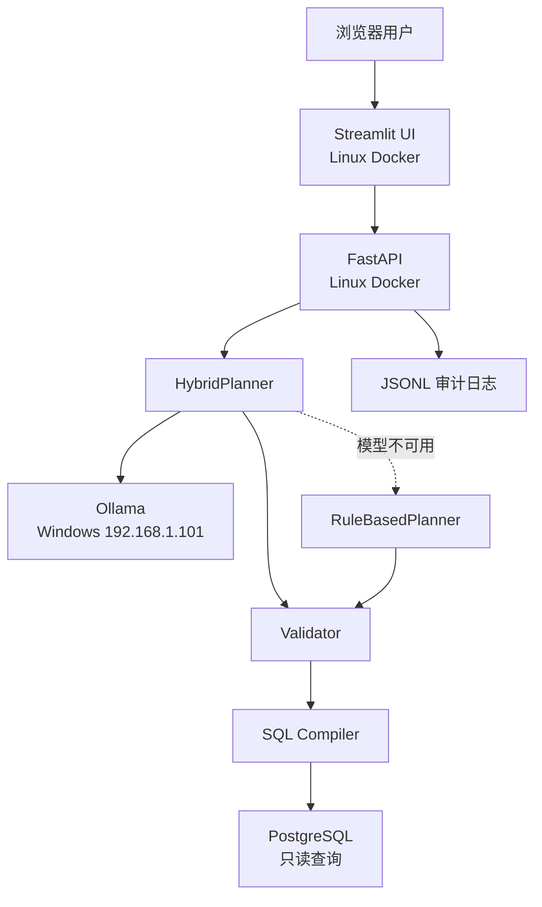

# 智能数据查询助手 Demo

这是一个可直接部署和演示的自然语言数据查询项目。用户在 Streamlit 页面输入中文问题，FastAPI 将问题转换为受约束的 QueryPlan，经过安全校验和参数化 SQL 编译后，使用只读账号查询 PostgreSQL。

项目支持两种规划方式：

- 规则 Planner：离线、稳定、便于基础验收；
- Ollama Planner：理解更自由的中文表达；
- Hybrid Planner：优先调用 Ollama，模型异常时自动回退到规则 Planner。

> 本项目只查询虚构的历史脱敏急救调度数据，不用于医疗诊断、电话定位、实时派车或生产调度。

## 当前状态

当前 Demo 已完成开发与端到端验收：

- PostgreSQL 初始化、模拟数据和 pgvector；
- 数据库只读账号与脱敏视图；
- FastAPI 查询接口；
- Streamlit 浏览器页面；
- Windows Ollama 局域网调用；
- JSON Schema 结构化模型输出；
- Pydantic 与 Validator 安全校验；
- Python 确定性时间计算；
- 参数化 SQL 编译与只读执行；
- JSONL 查询审计；
- Hybrid 故障回退和恢复；
- 四类自然语言查询验收。

## 系统架构



### 当前验证环境

| 项目 | 当前配置 |
|---|---|
| Linux/Docker 主机 | `192.168.1.198` |
| Windows/Ollama 主机 | `192.168.1.101` |
| Ollama 端口 | `11434` |
| Ollama 模型 | `qwen35-local:latest` |
| Planner 模式 | `hybrid` |
| API 端口 | `8000` |
| Streamlit 端口 | `8501` |
| PostgreSQL 端口 | `5432` |
| 项目时区 | `Asia/Shanghai` |

IP 地址属于当前局域网环境。更换网络或主机后，需要同步修改 `OLLAMA_BASE_URL` 和防火墙规则。

## 工程目录

```text
api/app/       FastAPI、Planner、QueryPlan、校验器、SQL编译器和数据库访问
ui/            Streamlit查询页面
db/init/       建表、模拟数据、索引、视图和只读账号
scripts/       静态检查、数据库冒烟测试和端到端测试
tests/         不依赖数据库的单元测试
docs/          架构、部署和真实数据库接入文档
compose.yaml   PostgreSQL、API和UI的Compose编排
.env.example   不含真实密码的配置模板
```

## 环境要求

### Linux 主机

- Docker 24 或更高版本；
- Docker Compose v2；
- Python 3；
- curl；
- 建议至少 2 核 CPU、4 GB 内存和 5 GB 可用磁盘。

### Windows 主机

- Windows 10/11；
- Ollama；
- 已导入的 GGUF 模型；
- Windows 与 Linux 位于同一可信局域网；
- 防火墙仅允许 Linux 主机访问 TCP 11434。

## Windows Ollama 配置

### 1. 模型目录

如需将模型保存在非系统盘，可在 Windows 环境变量中设置：

```text
OLLAMA_MODELS=D:\model
```

修改环境变量后需要完全退出并重新启动 Ollama。

### 2. 局域网监听

设置：

```text
OLLAMA_HOST=0.0.0.0:11434
```

这会让 Ollama 监听局域网接口。由于 Ollama 原生接口使用 HTTP，建议只在可信局域网中使用，并通过 Windows 防火墙限制来源地址。

当前防火墙应只允许：

```text
来源IP：192.168.1.198
目标端口：TCP 11434
```

### 3. 确认模型

在 Windows CMD 中执行：

```cmd
ollama list
```

预期包含：

```text
qwen35-local:latest
```

可直接测试：

```cmd
ollama run qwen35-local:latest "请只回答：模型运行正常"
```

### 4. 从 Linux 验证

```bash
curl -sS --max-time 5 \
  http://192.168.1.101:11434/api/tags |
  python3 -m json.tool
```

返回的模型列表中应包含 `qwen35-local:latest`。

## 快速启动

### 1. 创建项目配置

```bash
cp .env.example .env
nano .env
```

参考配置：

```dotenv
POSTGRES_DB=dispatch_demo
POSTGRES_USER=demo_admin
POSTGRES_PASSWORD=请替换为管理账号强密码
DEMO_READER_PASSWORD=请替换为只读账号强密码
POSTGRES_PORT=5432

PLANNER_MODE=hybrid
OLLAMA_BASE_URL=http://192.168.1.101:11434
OLLAMA_MODEL=qwen35-local:latest

API_PORT=8000
UI_PORT=8501
```

`.env` 包含真实密码，必须被 `.gitignore` 忽略，不能提交到版本库。

### 2. 启动服务

```bash
docker compose up -d --build
docker compose ps
```

所有服务最终应处于 `Up` 或 `healthy` 状态。

### 3. 访问系统

- Streamlit 页面：<http://localhost:8501>
- 局域网页面：<http://192.168.1.198:8501>
- FastAPI 文档：<http://localhost:8000/docs>
- API 存活检查：<http://localhost:8000/health/live>
- API 就绪检查：<http://localhost:8000/health/ready>

## 示例问题

- 查询最近 70 天各医院的派车数量；
- 找出最近 30 天海淀区派车超过 5 分钟的记录；
- 找 10 条与老人胸闷出冷汗意识模糊相似的警情；
- 统计最近 30 天各区的平均响应时间。

## 一次完整查询链路

1. Streamlit 接收用户问题和查询人标识；
2. UI 使用 HTTP POST 调用 FastAPI；
3. HybridPlanner 优先调用 Windows Ollama；
4. Ollama 只生成 JSON QueryPlan，不生成 SQL；
5. JSON Schema 约束字段类型、枚举值和数组结构；
6. Pydantic 再次验证模型输出；
7. Python 根据原始问题确定性计算相对时间；
8. Validator 应用默认值和安全上限；
9. Compiler 从固定模板生成参数化 SQL；
10. 只读数据库账号查询脱敏视图；
11. API 返回结果、Planner 来源、QueryPlan 和 SQL 模板；
12. Streamlit 展示指标、表格和调试信息；
13. API 将查询行为写入 JSONL 审计日志。

## Planner 模式

| 模式 | 行为 | 适用场景 |
|---|---|---|
| `rule` | 完全使用规则解析器 | 离线演示、稳定验收 |
| `ollama` | 只使用Ollama，模型失败则请求失败 | 模型专项测试 |
| `hybrid` | 优先Ollama，失败时规则兜底 | 当前推荐Demo模式 |

Hybrid 成功调用模型时：

```json
{
  "planner": "Ollama:qwen35-local:latest",
  "planner_warning": null
}
```

模型不可用或输出不合法时：

```json
{
  "planner": "rule-fallback",
  "planner_warning": "Ollama 不可用: ..."
}
```

## QueryPlan 安全边界

大模型只能返回受约束的 QueryPlan：

```json
{
  "intent": "aggregate",
  "filters": {
    "start_time": "2026-07-04T17:41:19+08:00",
    "end_time": "2026-09-12T17:41:19+08:00",
    "district": null,
    "hospital_name": null,
    "event_type": null,
    "dispatch_status": null,
    "min_dispatch_seconds": null
  },
  "group_by": ["hospital_name"],
  "metric": "count",
  "semantic_query": null,
  "limit": 20
}
```

允许范围包括：

- `intent`：`detail_search`、`aggregate`、`similar_case_search`；
- `group_by`：`hospital_name`、`district`、`event_type`、`day`；
- `metric`：`count`、`avg_dispatch_seconds`、`avg_response_seconds`；
- `limit`：1～100；
- 查询时间跨度：不超过 366 天。

模型无法携带任意 SQL、表名、函数名或排序表达式。

## 结构化输出

项目将 Pydantic 模型生成的 JSON Schema 传给 Ollama：

```python
"format": QueryPlan.model_json_schema(),
```

这比普通的：

```python
"format": "json",
```

约束更严格。例如 `group_by` 即使只有一个值，也必须是数组：

```json
{
  "group_by": ["hospital_name"]
}
```

模型输出后，后端仍使用：

```python
plan = QueryPlan.model_validate(plan_json)
```

进行第二次校验。不能因为模型支持Schema就删除后端校验。

## 确定性时间处理

大模型负责理解查询意图，Python 负责精确日期计算：

```python
start_time, end_time = _time_range(question, now)
plan.filters.start_time = start_time
plan.filters.end_time = end_time
```

当前支持：

- 今天；
- 昨天；
- 最近 N 天；
- 最近一周；
- 最近一个月；
- 最近一年；
- 某个完整年份；
- 未指定时间时默认最近 30 天。

例如“最近 70 天”会严格生成相差 70 天的起止时间，不依赖模型进行日期减法。

## 安全设计

- API 只使用 `demo_reader` 数据库账号；
- `demo_reader` 只能查询指定脱敏视图；
- UI 不持有数据库密码，也不直接连接PostgreSQL；
- 大模型不持有数据库密码，不生成或执行 SQL；
- 字段、过滤器、指标和分组使用代码白名单；
- 所有用户值通过数据库参数绑定；
- 默认查询最近 30 天；
- 返回数量硬上限为 100；
- 单次查询时间跨度不超过 366 天；
- 数据库查询设置超时；
- 原问题、QueryPlan、结果数量、耗时和成功状态写入审计日志；
- 模型故障时可回退到规则Planner。

## 测试

### 静态检查

```bash
./scripts/static-check.sh
```

### 数据库冒烟测试

```bash
./scripts/db-smoke-test.sh
```

### 原有端到端测试

```bash
./scripts/e2e-test.sh
```

### Ollama API测试

```bash
time curl -sS --max-time 30 \
  -X POST http://localhost:8000/api/v1/query \
  -H 'Content-Type: application/json' \
  -d '{
    "question": "查询最近70天各医院的派车数量",
    "user_id": "ollama_test"
  }' |
  python3 -m json.tool
```

验收重点：

- `planner` 为 `Ollama:qwen35-local:latest`；
- `planner_warning` 为 `null`；
- `group_by` 是数组；
- 时间范围严格符合问题；
- SQL来自固定模板；
- 查询结果和审计记录正常。

### 已完成的Ollama验收结果

| 查询类型 | 结果 | 本次耗时 |
|---|---:|---:|
| 按医院统计数量 | 通过，返回5行 | 16697 ms |
| 延迟派车明细 | 通过，返回0行 | 8252 ms |
| 相似警情 | 通过，返回10行 | 2945 ms |
| 各区平均响应时间 | 通过，返回5行 | 8080 ms |

返回0行不代表查询失败，只表示当前过滤条件和时间范围内没有匹配数据。

## 审计日志

日志位于API容器：

```text
/app/logs/query_audit.jsonl
```

通过Docker命名卷 `audit_logs` 持久保存。

查看最近一条记录：

```bash
docker compose exec -T api \
  tail -n 1 /app/logs/query_audit.jsonl |
  python3 -m json.tool
```

审计记录包含：

- UTC查询时间；
- 查询人标识；
- 原始问题；
- QueryPlan；
- 返回行数；
- 总耗时；
- 是否成功；
- 错误代码。

当前审计格式暂未记录Planner来源和回退警告。

## 常用运维命令

查看服务：

```bash
docker compose ps
```

查看日志：

```bash
docker compose logs --tail=100 api
docker compose logs --tail=100 ui
docker compose logs --tail=100 postgres
```

修改API源码后重建：

```bash
docker compose up -d --no-deps --build api
```

只修改UI源码后重建：

```bash
docker compose up -d --no-deps --build ui
```

停止服务但保留数据：

```bash
docker compose down
```

重新启动：

```bash
docker compose up -d
```

> 不要随意执行 `docker compose down -v`，因为 `-v` 会删除数据库卷和审计日志卷。

## 故障排查

### Planner显示rule-fallback

查看：

```json
"planner_warning": "..."
```

然后依次检查：

1. Windows Ollama是否启动；
2. `OLLAMA_HOST` 是否为 `0.0.0.0:11434`；
3. Windows防火墙是否允许Linux主机；
4. Linux能否访问 `/api/tags`；
5. `.env` 中模型名称是否与 `ollama list` 完全一致；
6. API容器中的环境变量是否正确；
7. 模型响应是否超过20秒。

### HTTP 404

如果 `/api/generate` 返回404，通常检查：

- 模型名称是否拼写错误；
- 是否遗漏 `:latest` 标签；
- 当前对外服务的Ollama进程是否读取了正确的模型目录。

### QueryPlan校验失败

如果看到：

```text
Input should be a valid list
```

确认API镜像包含：

```python
"format": QueryPlan.model_json_schema(),
```

并重新构建API。

### 时间正确但结果为空

检查：

- QueryPlan的起止时间；
- 数据库模拟数据所在日期；
- 地区、医院和事件类型过滤条件；
- 是否需要扩大查询范围。

### 浏览器无法访问

检查：

```bash
docker compose ps ui
docker compose logs --tail=100 ui
```

确认8501端口未被防火墙阻止。

## 当前限制

- 这是单机Demo，不是高可用架构；
- UI中的 `user_id` 由用户输入，不是真实身份认证；
- 没有SSO、JWT或细粒度业务权限；
- Ollama原生接口没有项目级鉴权和HTTPS；
- Windows IP变化后需要修改配置；
- 模型规划耗时约3～17秒；
- UI请求超时为30秒；
- Ollama Planner超时为20秒；
- 任意起止日期表达尚未完整支持；
- 审计日志尚未记录Planner来源；
- 没有限流、队列、缓存和并发保护；
- 没有生产级监控、告警、备份和灾难恢复。

## 生产化前必须补充

- SSO/JWT身份认证；
- HTTPS或可信反向代理；
- Ollama接口鉴权与网络隔离；
- 用户、角色和数据范围权限；
- 请求限流、并发控制和任务队列；
- 结构化日志、指标、链路追踪和告警；
- 数据脱敏审查和安全测试；
- 数据库备份、恢复演练和高可用；
- 模型输出质量评估和回归测试；
- 更完整的日期区间解析；
- 审计日志记录Planner来源和回退原因。

## Demo验收结论

截至2026年9月12日，以下链路均已完成验证：

```text
浏览器
→ Streamlit
→ FastAPI
→ Windows Ollama
→ JSON Schema QueryPlan
→ Python时间归一化
→ Validator
→ 参数化SQL
→ PostgreSQL只读查询
→ 页面结果
→ JSONL审计
```

同时已验证：

- Ollama不可用时自动切换到规则Planner；
- Ollama恢复后无需重启API即可重新使用模型；
- API和UI容器可以独立重建；
- PostgreSQL数据卷和审计日志卷可以持久保存。

因此，本项目已达到学习型、局域网演示型智能数据查询Demo的完成标准。

